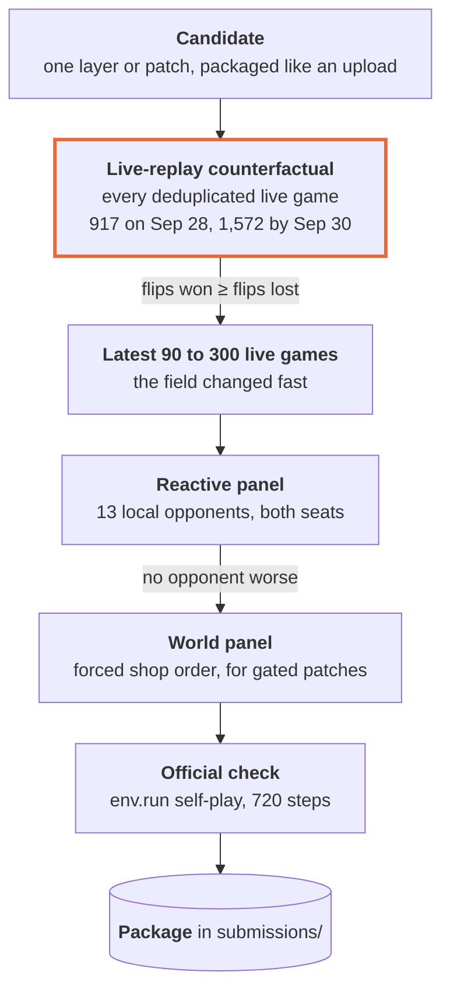

# Evaluation

How every number in this repository was produced, and what we learned about measuring in this competition.

## Tools

| Method | How | Good for | Limits |
|---|---|---|---|
| Local engine | `kaggle-environments` 1.32.7. Replaying both sides' actions from a server replay reproduces the server's score exactly | the basis of everything below | |
| Fast arena | `tools/fastarena.py` loads only this environment (the package loads 20+ environments by default): about 90 MB per process, 14 processes play about 3 games a second | large batches | |
| Live-replay counterfactual | Keep the rival's recorded actions, the real seed and the real shop order (`--force-shops`); replace only our side with the candidate. First re-run our own recorded side and check that the score matches exactly. Tools: `tools/cfreplay.py`, `gold/tools/cfroute.py`, `research/carrera/ab_replay.py` (cached by code hash, `PYTHONHASHSEED=0`) | the real field, including opponents we could not emulate | rivals do not react; adaptive top agents cannot be replayed once the game diverges |
| Reactive panel | Local opponents that react: cha22, the public bases morewheat, rescue, herdsafe_race and v15stack, and our emulations in `research/panel/` (below). Fresh seeds that were never used for tuning, alternating seats, per-opponent paired comparison. 7 opponents until Sep 26, 13 from Sep 27 (`research/carrera/panel.py`) | opponents that adapt to us | panel rivals share 95% to 100% of our farm layout, so it mostly tests market behaviour; its composition differs from the live field |
| World panels | Force a shop prefix (`tools/forceshops.py`) to test a gated patch where it triggers: tomato worlds (`research/carrera/tomato_panel.py`), wool worlds, the replays of a strong production team (`research/carrera/unreal_panel.py`, where we sit in its live opponents' seats) | rare world types | |
| Economics breakdown | `tools/econ.py`, `research/carrera/replay_econ.py`: exact re-pricing with a per-trade ledger, net cash by good and by day | explaining a result, not just measuring it | |
| Head-to-head with our own old versions | quick smoke test | | self-play bias: avoiding the mirror is enough to win |
| Official check | `tools/official_check.py`: the official `env.run` self-play, both sides `DONE`, 720 steps | run before every upload | |
| Live comparison | Two submissions compared at the same age, or over the same window of games (a logistic performance rating at scale 70 over a chosen window) | judging live results | the live field changes by the hour |

Figure 03 in [solution.md](solution.md#4-tick-wheat-arbitrage-around-the-towns-consumption), columns 3 and 4, shows two live-replay counterfactuals unit by unit.

### Emulated opponents (`research/panel/`)

| Opponent | Emulates |
|---|---|
| `emu_eager`, `emu_eager_m` | cha22 variants that sell milk, strawberries and wool the moment they arrive, from slot 0 |
| `emu_tick0`, `emu_tick30` | slot-0 wheat tick arbitrage without a guard (`emu_tick30` in lots of 30) |
| `emu_tick3` | slot-0 arbitrage one step off (buy at `s % 4 == 3`, sell at the tick) |
| `emu_prebuy0` | the pre-buy trap: buy at `s % 4 == 3` from slot 0, sell in slot 9 at the tick |
| `emu_antifade`, `emu_antifade2` | arbitrageurs that trade against a fader (normal and large lots) |
| `emu_sw8` | the sandwich trap: at the tick buy in slot 0 and sell in slot 8 of the same step, ahead of a rival's last-slot buy |

All are local test opponents built on cha22 and keep its Apache-2.0 notices.

## Gates a change had to pass

From Sep 27 a candidate needed all of the following before it could replace a package:

1. Live-replay counterfactual on every deduplicated live game we had (917 games on Sep 28, 1572 by Sep 30): at least as many flips won as lost, and money per game not lower.
2. The latest 90 to 300 live games as a separate check, because the field changed quickly.
3. The reactive panel: no opponent worse.
4. A world panel for gated production patches, and the economics breakdown for the targeted good (no other good worse).
5. The official check and the per-step time limit (v11, for example, took at most 0.05 s per step).

## What we learned about measuring

- **Force the shop order.** Weed random draws on empty tiles share the random stream with the shop draw, so a change that alters the number of empty tiles also changes which shops open. Every local A/B forces the shop order.
- **Worlds dominate.** After swapping seats, 78% to 91% of worlds give exactly the same money gap. 420 games contain far fewer independent samples than it seems; sample more worlds rather than more seeds of the same world.
- **Count flips, not money.** The final ranking only sees wins. A change can add money in games already won and still lose games. Several changes in [experiments.md](experiments.md) raised money per game and were dropped for one or two flipped losses.
- **Self-play lies.** Route tables went 80 W / 16 L against our own champion but fell from 263 to 148 wins of 280 against the reacting cha22 family. Our own versions beat each other mainly by selling earlier in mirror games.
- **Keep tuning and evaluation worlds apart.** v7's selling band was chosen on 40 fixed worlds; its advantage disappeared on fresh worlds.
- **Compare live ratings at the same age and in the same window.** A rating 10 hours after upload is still climbing in the high band. v7b froze at 2591 and looked better than v7c, which stood at 2554 at that moment (it later froze at 2563.5); aligned by hours since upload, v7c led from hour 2 to hour 8 and tied at hour 10. A version uploaded on Sep 22 froze at 2534; the same code uploaded on Sep 24 reached only 2100.
- **Replays go stale.** A test set built from early replays does not contain the opponents that arrive in the last days. On Sep 29 most of our games were against submissions uploaded after Sep 28 18:47, and our replay gains did not carry over to them.
