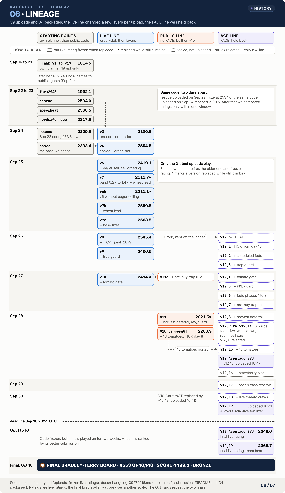

# Submission history

All 39 uploads of team 42, in order. Ratings are the frozen rating when a submission was replaced, or the final rating for the two that ran to the end. Ratings from different days are not directly comparable, because the field kept getting stronger; see [the same-age comparison](#rating-at-the-same-age) below. Package hashes are in [submissions/README.md](../submissions/README.md).

<picture>
  <source media="(prefers-color-scheme: dark)" srcset="img/06_lineage_dark.png">
  
</picture>

## Phase 1: Frank's own planner (Sep 16 to 21, uploaded by ffy208)

| # | Uploaded (UTC) | Version | Change | Rating |
|---|---|---|---|---|
| 1 | 09-16 21:34 | Frank v1 | planner plus scheduler, first version | 668.6 |
| 2 | 09-16 21:56 | Frank v2 | plan within the labour cap | 690.2 |
| 3 | 09-16 22:18 | Frank v3 | fertilize multi-harvest crops | 707.7 |
| 4 | 09-16 22:58 | Frank v4 | buy cows at the start, sell in lots | 905.9 |
| 5 | 09-16 23:15 | Frank v5 | tighter labour cap | 776.4 |
| 6 | 09-17 00:03 | Frank v9 | two quadrants, crowding factor | 728.5 |
| 7 | 09-17 01:16 | Frank v10 | release animals later | 766.1 |
| 8 | 09-17 22:13 | Frank v11 | track the rival's inventory, prioritized selling | packaging error |
| 9 | 09-17 22:15 | Frank v11b | packaging fixed | 817.5 |
| 10 | 09-17 22:15 | Frank v11b | the same file again, replacing the broken package | 767.3 |
| 11 | 09-18 00:20 | Frank v12 | no cap on land purchases | 775.1 |
| 12 | 09-18 02:15 | Frank v13 | higher labour capacity | 762.9 |
| 13 | 09-18 19:02 | Frank v14 | opening with 3 cows and 2 sheep | 884.4 |
| 14 | 09-18 19:26 | Frank v15 | three quadrants | 804.0 |
| 15 | 09-19 04:40 | Frank v16 | idle units wait in place | 807.6 |
| 16 | 09-20 05:43 | Frank v17 | parameters from a self-play league | 979.2 |
| 17 | 09-20 06:38 | Frank v18 | wheat on at least 15 tiles | 906.1 |
| 18 | 09-20 20:25 | Frank v19 | fertilize one-time crops | 963.8 |
| 19 | 09-21 00:28 | Frank v19 | the same file again, for a second rating sample | 1014.5 |

Frank v6 to v8 were never uploaded. The planner had econ (per-tile daily return of each crop and animal, land and hiring decisions), tracker (rival inventory from stock changes), jobs and planner (watering, harvest, feeding, care, fertilizing, planting, building as tasks), scheduler (priority dispatch of the farmer and helpers) and trader modules. In a local round robin on Sep 24, versions v1 to v19 lost all 2240 games against seven public-level agents; a rating of 1000 against 2000+ for the public route-replay agents ended this line.

## Phase 2: public bases (Sep 22 to 24)

| # | Uploaded (UTC) | By | Version | Content | Active | Rating |
|---|---|---|---|---|---|---|
| 20 | 09-22 19:22 | ffy208 | farm2945 | thomastschinkel's public agent, verbatim | 6.9 h | 1992.1 |
| 21 | 09-22 22:02 | ffy208 | rescue | Dmitrii Gluzdov's Sep 22 version, verbatim | 13.5 h | 2534.0 |
| 22 | 09-23 02:14 | ffy208 | morewheat | Dmitrii Gluzdov's Sep 23 version, verbatim | 29.8 h | 2368.5 |
| 23 | 09-23 11:33 | kefeiyan | herdsafe_race | the public herd-safe race variant, verbatim | 20.5 h | 2317.6 |
| 24 | 09-24 08:00 | kefeiyan | rescue | the same code as #21, re-measured in the same window as #25 | 10.8 h | 2100.5 |
| 25 | 09-24 08:00 | kefeiyan | v3 | rescue + order-slot | 10.8 h | 2180.5 |

The two rescue ratings are a lesson in themselves: uploaded on Sep 22, when the field was weaker, it froze at 2534.0; the same code uploaded on Sep 24 reached 2100.5, a difference of 433.5.

## Phase 3: cha22 plus our layers (from Sep 24, uploaded by kefeiyan)

| # | Uploaded (UTC) | Version | Change | Active | W / L / D | Rating |
|---|---|---|---|---|---|---|
| 26 | 09-24 18:47 | cha22 | Abhinav0370's public agent, verbatim | 7.0 h | 72 / 14 / 3 | 2333.4 |
| 27 | 09-24 18:47 | v4 | + order-slot | 19.6 h | 113 / 46 / 0 | 2504.5 |
| 28 | 09-25 01:45 | v6 | + room guard, eager sell (0.3× to 0.9×), sell ordering | 13.7 h | 91 / 23 / 0 | 2419.1 |
| 29 | 09-25 14:22 | v7 | eager band 0.2× to 1.4×, wheat lead | 1.7 h | 25 / 2 / 0 | 2111.7 (still climbing) |
| 30 | 09-25 15:24 | v6b | v6 without the eager ceiling | 4.7 h | 66 / 7 / 0 | 2311.1 (still climbing) |
| 31 | 09-25 16:06 | v7b | v6b + wheat lead | 15.8 h | 113 / 25 / 0 | 2590.8 |
| 32 | 09-25 20:03 | v7c | + SHEEPFEED, FERTMORE | 23.2 h | 116 / 40 / 0 | 2563.5 |
| 33 | 09-26 07:55 | v8 | + TICK | 22.6 h | 84 / 70 / 0 | 2545.4 (peak 2679) |
| 34 | 09-26 19:12 | v9 | + trap guard | 29.0 h | 126 / 50 / 0 | 2490.6 |
| 35 | 09-27 06:30 | v10 | + tomato gate | 25.1 h | 131 / 31 / 0 | 2494.4 |
| 36 | 09-28 00:09 | v11 | + pre-buy trap extension, end-of-day deferral, rev_guard | 18.6 h | 118 / 8 / 0 | 2021.5 (still climbing) |
| 37 | 09-28 07:36 | V10_CarreraGT | v11 + 18 tomatoes, TICK from day 8 | 57.1 h | 158 / 194 / 0 | 2206.9 |
| 38 | 09-28 18:47 | V12_AventadorSVJ | the sealed ace; main.py byte-identical to v12_15 | to the end | last 1000: 467 / 533 / 0 | 2046.0 |
| 39 | 09-30 16:41 | v12_19 | + sheep cash reserve, late tomato crews, layout-adaptive fertilizer | to the end | 450 / 439 / 1 | 2065.7 |

What each version changed, and the evidence, is in [solution.md](solution.md). The full record of Sep 27 to Oct 16, with the reason behind every iteration, is in [changelog_0927_1016.md](changelog_0927_1016.md).

## The last four uploads

| Upload | Plan at the time | Why then | Replaced |
|---|---|---|---|
| v11 (Sep 28 00:09) | final pair: V10_CarreraGT plus V12_AventadorSVJ | the name CarreraGT was kept for the final public-line version; the strongest stable public-line version went up first under a working name, to check deployment and build up games | v9 |
| V10_CarreraGT (Sep 28 07:36) | unchanged | a test version and the final version should be the same submission: server validation plus a day of live games is the check (a former #1 had advised keeping a day for it), and the games of a submission that is later replaced do not count in the final Bradley-Terry fit. Uploaded before the ace, a later re-upload would only replace itself. In code it was no worse than v11: identical results on 1142 replays, 329 games better and 8 worse, +67 per game | v10 (v11 kept climbing) |
| V12_AventadorSVJ (Sep 28 18:47) | unchanged; originally planned for the night of Sep 28 or the morning of Sep 29 | the strongest line had been held back so rivals could not adapt to it (TICK drew predators within half a day). Once final, uploading early let it settle and left time for a fix, and the exposure of the fade layers was bounded | v11 |
| v12_19 (Sep 30 16:41) | changed to V12 plus an improved V12 | an audit of the latest losses showed tomatoes, strawberries and eggs short by thousands against freshly uploaded final versions. Same-window comparisons were small: over the latest 50 games V12 won 18 and CarreraGT 15, over the latest 8 games 2 and 0; on the latest 16 games replayed, V12 won 3, CarreraGT 2, and v9, v8 and v7c 1 each; on 1478 replays the ace beat the CarreraGT code by 24 flips to 7. The displayed ratings (2206.9 against 2192.1) were not used, because the two had gone live at different times against different opponents | V10_CarreraGT |

- **The hedge.** On Sep 29 keeping V10_CarreraGT (no FADE, TICK from day 8) as a hedge of a different style was proposed; two identical copies of the ace were rejected as pointless. On Sep 30 the choice was V12 plus an improved V12, which gave up the hedge. After the deadline the two finals had almost identical results (the latest 12 games and the 51 games of Oct 6 had exactly the same outcomes), and the Oct 1 review listed "two slots from one base are no independent insurance" as a lesson.
- **Names.** V10_CarreraGT and V12_AventadorSVJ were chosen on Sep 27. The V10 prefix marks the public line (built on the live v10, without FADE) and V12 the ace line. The names came first and the code evolved afterwards, so CarreraGT is in fact v11 plus x18g plus TICK from day 8.
- **Why no production rewrite at the end.** On Sep 28 and 29 we tried a from-scratch production agent, executing a strong team's plans, and re-picking routes; all came out negative or flat ([experiments.md](experiments.md)). Our executor could not even carry out a 2770-rated player's own plan well: about 9% less output, which became about 20k per game in head-to-head play. The written conclusion on the night of Sep 28 was that no route to 2700+ existed before Sep 30. With less than a day left and only one slot to change, a broken upload would have restarted from 600 and lost a running submission, so the final day went into small fixes on the ace.

## Rating at the same age

Live rating at fixed hours after upload, taken from the episode list (the rating after each game; rule: the last rating at or before upload time + h).

| Version | 2 h | 4 h | 6 h | 10 h | 14 h | 18 h | 22 h |
|---|---|---|---|---|---|---|---|
| cha22 (public) | 2141 | 2302 | 2342 | | | | |
| v4 | 2167 | 2438 | 2454 | 2481 | 2487 | 2513 | |
| v6 | 2134 | 2290 | 2331 | 2372 | 2419 | | |
| v6b | 2041 | 2269 | | | | | |
| v7b | 2172 | 2417 | 2485 | 2545 | 2566 | | |
| v7c | 2280 | 2470 | 2520 | 2543 | 2560 | 2572 | 2555 |
| v8 | 2594 | 2597 | 2613 | 2596 | 2570 | 2559 | 2554 |
| v9 | 2114 | 2375 | 2448 | 2484 | 2502 | 2510 | 2508 |
| v10 | 2098 | 2311 | 2345 | 2388 | 2410 | 2451 | 2487 |
| v11 | 1582 | 1803 | 1826 | 1899 | 1960 | 2012 | |
| V10_CarreraGT | 2457 | 2496 | 2479 | 2483 | 2471 | 2443 | 2423 |
| v12_19 | 2155 | 2176 | 2170 | 2155 | 2154 | 2149 | 2144 |

The versions went live at different times of day against different opponents, so the table is only a rough guide. v8's first hours were against rivals with no defence against TICK (it peaked at 2679); predators appeared that afternoon. v11 was matched slowly, mostly against 1700 to 2000 opponents, and was replaced at 18.6 hours while still climbing. The episode list of V12_AventadorSVJ keeps only its latest 1000 games (from about 24 hours after upload); three hours after upload it stood at 2423 (41 W / 12 L). By the time v12_19 went live the whole band had compressed (the silver line was near 2100), and it hardly rose after two hours.

