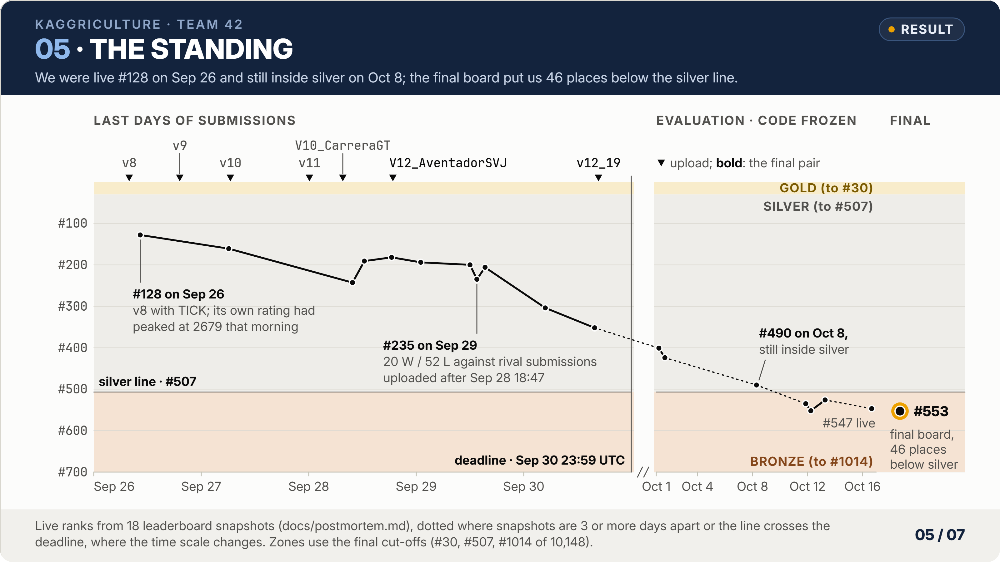
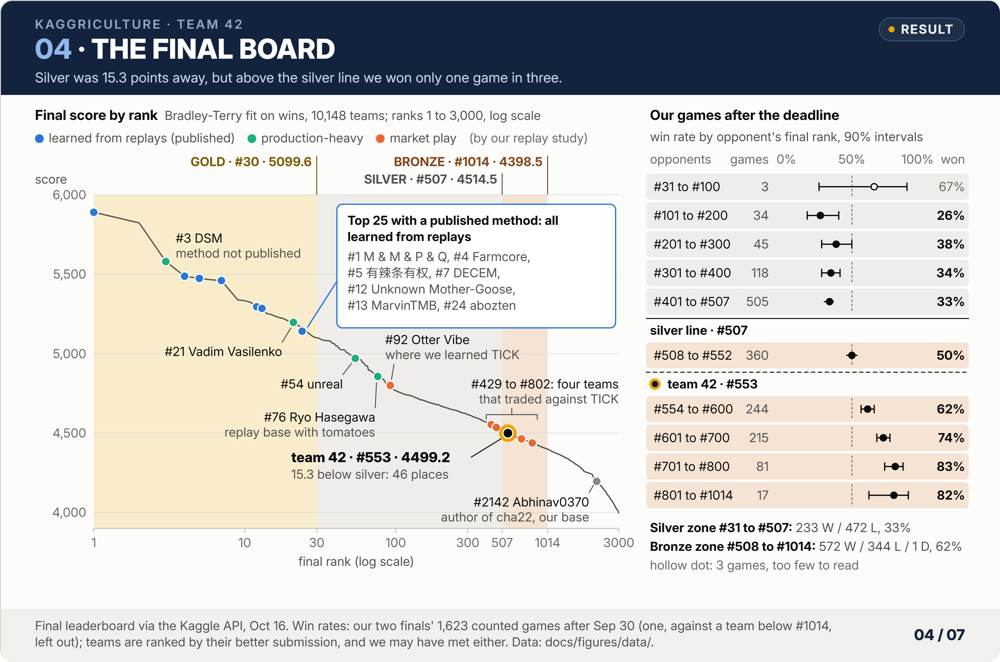
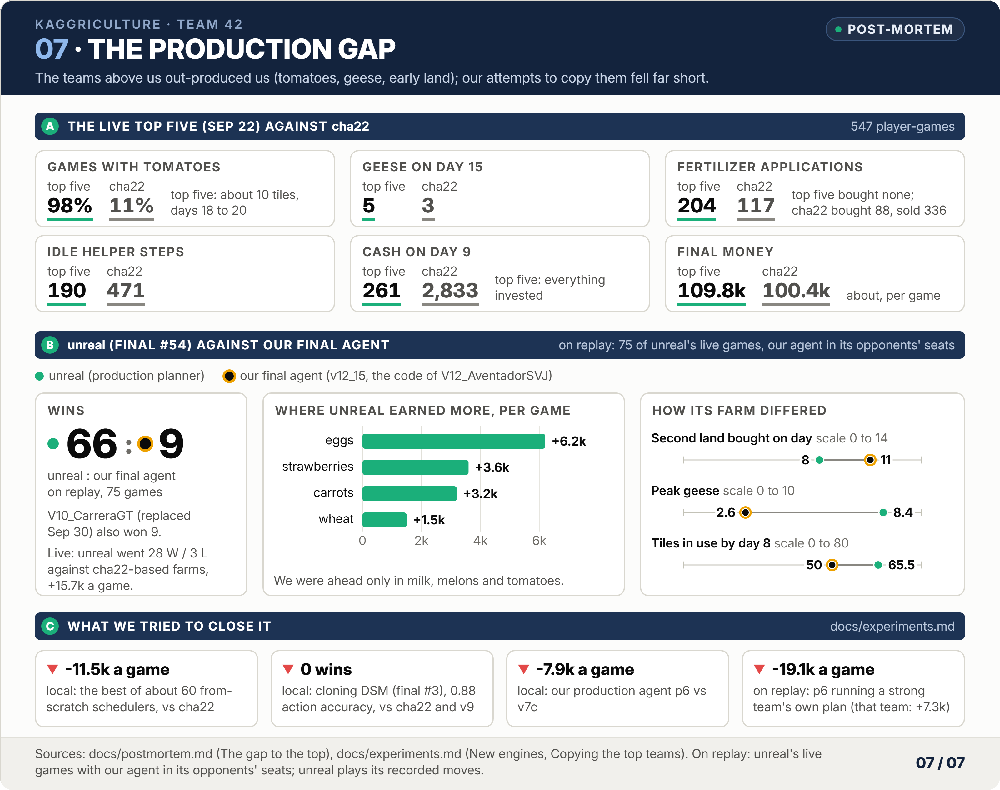

# Post-mortem

How the standing developed, why we finished outside the silver zone, what separated us from the top, and what we would do differently.

## Final standing

| Measure | Value |
|---|---|
| Final leaderboard (Bradley-Terry, published 2026-10-16) | **#553 of 10,148, 4499.2, bronze medal** |
| Final medal lines | gold #30 at 5099.6; silver #507 at 4514.5 (15.3 above us, 46 places); bronze #1014 at 4398.5 (100.7 below us) |
| Live leaderboard at the end (2026-10-16, about 16:00 UTC) | #547 of 10,148, 2065.7 (taken from v12_19); live ratings use a different scale from the final scores |
| Live medal lines at that time | gold #30 at 2768.3; silver #507 at 2093.1 (27.4 above us); bronze #1014 at 1843.4 (222.3 below us) |
| Best recorded live rank | Sep 26 10:23 UTC, #128 at 2606.7 (v8's own rating had peaked at 2679 at 09:39) |
| Our estimate before the final board (live scale) | The final board fits only games in which both sides were still active at the end. Of V12_AventadorSVJ's 333 games before the deadline only 102 count: of the 228 opponent submissions it met only before the deadline, 209 were replaced by their teams' final versions on Sep 30. About 85% of the counted games were played after the deadline. Our Bradley-Terry fit on the live scale (scale 400, maximum likelihood, opponents at their latest post-deadline live rating): V12_AventadorSVJ about 2038 (701 games, 48.2% won after the deadline), v12_19 about 2036 (657 games, 48.9%). On Oct 13 the same fit over the teams ranked #470 to #560 put us 66th of the 88, about 30 places and nearly 30 live points below the silver line. The final board put us 46 places below it. |

<picture>
  <source media="(prefers-color-scheme: dark)" srcset="img/05_standing_dark.png">
  
</picture>

## Standing over time

| Time (UTC) | Rank / teams | Score | Gold line | Silver line | Bronze line | Margin to silver |
|---|---|---|---|---|---|---|
| Sep 26 10:23 | 128 | 2606.7 | | 2394.6 | 2196.4 | +212.1 |
| Sep 27 06:08 | 161 | 2544.0 | | 2351.4 | 2134.3 | +192.6 |
| Sep 28 09:46 | 243 / 10113 | 2436.8 | 2772.7 | 2293.2 | 2086.3 | +143.6 |
| Sep 28 12:25 | 191 | 2484.6 | 2772.9 | 2283.8 | 2078.9 | +200.8 |
| Sep 28 18:30 | 182 | 2483.5 | 2745.2 | 2258.0 | 2046.6 | +225.5 |
| Sep 29 01:00 | 194 | 2443.1 | 2739.9 | 2241.6 | 2030.3 | +201.5 |
| Sep 29 12:00 | 200 / 10157 | 2422.4 | 2741.8 | 2206.7 | | +215.7 |
| Sep 29 13:32 | 235 | 2391.8 | 2747.5 | 2197.7 | 1975.9 | +194.1 |
| Sep 29 15:22 | 206 | 2405.4 | 2738.6 | 2188.1 | 1958.3 | +217.3 |
| Sep 30 04:49 | 304 | 2296.1 | 2735.8 | 2135.1 | | +161.0 |
| Sep 30 15:49 | 352 / 10213 | 2210.8 | 2744.2 | 2099.1 | | +111.7 |
| Oct 1 04:38 | 401 / 10246 | 2164.6 | | 2082.5 | 1840.3 | +82.1 |
| Oct 1 15:02 | 424 | 2144.1 | | 2065.4 | | +78.7 |
| Oct 8 06:58 | 490 / 10148 | 2065.8 | | 2057.0 | 1816.9 | +8.8 |
| Oct 11 21:00 | 535 | 2057.2 | | 2078.5 | 1830.3 | -21.3 |
| Oct 12 05:50 | 552 | 2043.4 | | 2083.9 | 1833.2 | -40.5 |
| Oct 13 06:47 | 526 | 2070.3 | | 2084.4 | | -14.1 |
| Oct 16 16:01 | 547 / 10148 | 2065.7 | 2768.3 | 2093.1 | 1843.4 | -27.4 |

Final board (Bradley-Terry, a different scale): **#553 of 10,148 at 4499.2**; gold #30 at 5099.6, silver #507 at 4514.5 (15.3 above us), bronze #1014 at 4398.5.

## Why we fell from about #180 to #547 on the live board

| Period | What happened | Rank, margin to silver |
|---|---|---|
| Sep 26 to 27 | Teams trading against TICK appeared within half a day and the cha22 variants kept improving; v8 fell from 2679 to 2545 | #128 → #161, +212 → +193 |
| Sep 28 to 29 | Strong teams uploaded their final versions. On Sep 29, 72 of our 95 games were against submissions uploaded after Sep 28 18:47: we went 20 W / 52 L against them and 14 W / 9 L against older ones. The big losses were to production-heavy farms (second land on day 8, many geese, cows and sheep, tomatoes sized to the shops) | #182 to #243, +144 to +226 |
| Sep 30 to Oct 1 | More final versions arrived and the whole score band compressed, so the same gap meant more places | #304 → #424, +161 → +79 |
| Oct 1 to 16 | Code frozen; two weeks of evaluation games against the fixed field of final versions. Our two submissions (the same base) won about 48% a day against opponents averaging about 2040; we touched the silver line around Oct 8 and stayed 14 to 41 points below it after Oct 11 | #490 (+8.8) → #547 (-27.4) |

The silver line moved from 2293 (Sep 28) down to 2057 (Oct 8) and back up to 2093 (Oct 16), while our score fell from 2484 to the 2043 to 2070 band. A check on Oct 1 found no evidence that our code had leaked (the repository was private, and all 102 of our Kaggle test notebooks and their 19 datasets were private). The data pointed instead to the narrow reach of our market edge, the late wave of new final versions and the production gap. The final versions that beat us had played 75 to 85 ladder games before those wins, so they were not untested late uploads.

## The final board

<picture>
  <source media="(prefers-color-scheme: dark)" srcset="img/04_final_board_dark.png">
  
</picture>

Every top-25 team that has published its method trained a neural policy on replays of strong agents (behaviour cloning or supervised fine-tuning); at least three of them, #1, #12 and #13, then refined it with self-play PPO.

| Final rank | Team | Approach (from their public repository or write-up) |
|---|---|---|
| 1 | M & M & P & Q | behaviour cloning, self-play PPO and heuristic patches; a 12-block, 10.23M-parameter Transformer choosing unit actions and market orders ([repository](https://github.com/msdsm/kaggriculture-1st-solution)) |
| 2 | Victor @ Tufa Labs | no published method found |
| 3 | DSM | method not published; in our replay study it played like an adaptive scheduler, and it led the live board in late September |
| 4 | Farmcore | behaviour cloning on the actions the engine actually executed, staged fine-tuning and weight soups ([discussion](https://www.kaggle.com/competitions/kaggriculture/discussion/745119)) |
| 5 | 有辣条有权 | supervised fine-tuning on winners' replays, with both final models trained from scratch in the last three days ([write-up](https://www.kaggle.com/competitions/kaggriculture/writeups/its-sft-all-the-way-down)) |
| 7 | DECEM | behaviour cloning with an 8.2M-parameter entity Transformer, specialised on the strongest team's latest version ([repository](https://github.com/Decem-Y/kaggriculture-bc)) |
| 12 | Unknown Mother-Goose | behaviour cloning, recurrent policies, PPO self-play with opponent pools; its two final models come from an M & M & P & Q branch and a DSM branch ([repository](https://github.com/LinkinPony/kaggriculture-rl-public)) |
| 13 | MarvinTMB | behaviour cloning on two days of replays between players rated 2600 or more, then self-play PPO against a league of its own snapshots; an actor of about 0.95M parameters, about 10 hours of training on one RTX 5090 ([repository](https://github.com/CarsonBurke/kaggriculture)) |
| 24 | abozten | per-unit closed-loop behaviour cloning of top teams' ladder games, fine-tuned on DSM's newest versions, with calibrated decoding ([write-up](https://www.kaggle.com/competitions/kaggriculture/writeups/cloning-the-best-farmer-on-one-rtx-5070)) |

| Teams we studied | Final rank |
|---|---|
| Vadim Vasilenko (production-heavy farms) | 21 |
| unreal (production planner that beat our final agent 66 to 9 on replays) | 54 |
| Ryo Hasegawa (replay base with tomatoes) | 76 |
| Otter Vibe (where we learned the tick arbitrage) | 92 |
| teams that traded against TICK: lumen, curiosity, kwon yong deuk, Sho Saga | 429, 464, 681, 802 |
| **team 42 (cha22 base plus market layers)** | **553** |
| Abhinav0370, author of the public cha22 base | 2142 |

Our two finals after the deadline, by the opponent's final rank (the games that count in the final fit; before the deadline we went 2 W / 13 L against the final top 100):

| Opponent's final rank | Games | Won | Lost | Win rate | Money per game |
|---|---|---|---|---|---|
| 31 to 100 | 3 | 2 | 1 | 67% | -1201 |
| 101 to 300 | 79 | 26 | 53 | 33% | -3351 |
| 301 to 507 (lower silver zone) | 623 | 205 | 418 | 33% | -1937 |
| 508 to 1014 (bronze zone) | 917 | 572 | 344 (+1 draw) | 62% | +2400 |

Over the whole silver zone (#31 to #507): 233 W / 472 L in 705 games (33%). In finer bands, with 90% Wilson intervals (Figure 04, right):

| Opponent's final rank | Games | W | L | D | Win rate | 90% interval |
|---|---|---|---|---|---|---|
| 31 to 100 | 3 | 2 | 1 | 0 | 67% | 25% to 92% |
| 101 to 200 | 34 | 9 | 25 | 0 | 26% | 16% to 40% |
| 201 to 300 | 45 | 17 | 28 | 0 | 38% | 27% to 50% |
| 301 to 400 | 118 | 40 | 78 | 0 | 34% | 27% to 41% |
| 401 to 507 | 505 | 165 | 340 | 0 | 33% | 29% to 36% |
| 508 to 552 | 360 | 180 | 180 | 0 | 50% | 46% to 54% |
| 554 to 600 | 244 | 151 | 92 | 1 | 62% | 57% to 67% |
| 601 to 700 | 215 | 160 | 55 | 0 | 74% | 69% to 79% |
| 701 to 800 | 81 | 67 | 14 | 0 | 83% | 75% to 89% |
| 801 to 1014 | 17 | 14 | 3 | 0 | 82% | 63% to 93% |
| 1015 and below | 1 | 1 | 0 | 0 | 100% | 27% to 100% |

Included: games ending after Sep 30 between final submissions; 1 game in which the opponent's agent failed and 9 against teams missing from the final board are excluded. Teams are ranked by their better submission, and we may have met either.

Fitting a logistic curve to these 1623 games, with our final score fixed at 4499.2 and each opponent at its final score, gives a scale of about 92 points per factor e in the odds. The fit rests on opponents within about 150 points of us, so it is rough beyond that, but it gives the sizes:

| Opponent | Final score | Gap | Our expected win rate |
|---|---|---|---|
| bronze line (#1014) | 4398.5 | -100.7 | 75% |
| silver line (#507) | 4514.5 | +15.3 | 46% |
| #100 (extrapolation) | 4768.1 | +268.9 | 5% |
| gold line (#30, extrapolation) | 5099.6 | +600.4 | under 1% |

Observed: against #101 to #200 we won 9 of 34 (26%, 90% interval 16% to 40%), far above the fit, so the two extrapolated rows only show the direction. Silver was within reach: the fit gives us 46% against a team at the silver line. Above it we won about one game in three, whoever the opponent. The teams known mainly for market play (Otter Vibe #92, four teams that traded against TICK between #429 and #802, and us at #553) all finished below the production and learned-policy teams.

## The gap to the top

<picture>
  <source media="(prefers-color-scheme: dark)" srcset="img/07_production_gap_dark.png">
  
</picture>

### The field on Sep 26

The top 120 by their first 12 steps:

| Family | Teams | Ranks | Notes |
|---|---|---|---|
| DSM-style opening | 13 | 4 to 109 | the same first 12 steps as DSM's Sep 24 version; code not public at the time. Several were not hand-written schedulers: Unknown Mother-Goose and Russell Kirk (later 有辣条有权) ran policies trained on replays, and mtmr_s1 played an opening book taken from DSM and DECEM replays |
| Ryo Hasegawa family | 10 | 28 to 113 | cha22-style replay bases with changes; they plant tomatoes |
| cha22 family | 19 | 66 to 120 | the same base as ours; they differ in market layers |
| others | 1 to 3 each | | mostly their own programs |

The top five (547 seats on Sep 22) against cha22:

| Measure | Top five | cha22 |
|---|---|---|
| Games with tomatoes | 98%, about 10 tiles on days 18 to 20 | 11% |
| Geese on day 15 | 5 | 3 |
| Fertilizer | 204 applications, none bought | 117 applications, 88 bought, 336 sold |
| Idle helper steps | 190 | 471 |
| Cash on day 9 | 261 (everything invested) | 2833 |
| Final money | about 109.8k | about 100.4k |
| Selling | about 2 units per high-value sale; in 99.9% of steps with sales the first sell sits in slot 0 | about 4 per sale |

The top teams win on adaptive production (tomatoes, geese, fertilizer, labour use), not on price: DSM and Vadim got almost the same average price for every good, and DSM won on volume.

### Sep 26 to 27

| Finding | Detail |
|---|---|
| The 26 of v8's latest 94 games that v12_3 still lost on replay | 13 to production-heavy non-mirror teams (Vadim -52.8k, Mother-Goose -24.5k, ActiveMusyoku -18.5k and others), 13 narrow losses to near-mirror cha22 variants (-0.1k to -4.9k) |
| Production-heavy teams | they out-earn us in strawberries (+7k to +24k), tomatoes (+4k to +15k), eggs (+3k to +8k, with 3 to 5 more geese) and carrots; the Vadim family (7 teams in the top 40) earned 22k more in wool in 4-wool-shop worlds. We were ahead only in melons (+4.6k) and fertilizer sales (+3k to +5k) |
| How near-mirror variants beat us | the same route skeleton, with crops switched by world: 18 to 23 tomatoes in pizza and farmers'-market worlds (we plant 10), 70 to 110 carrots with two pet cafés, 12 more strawberries on days 10 to 14 in strawberry worlds; 23% of them sell milk, strawberries and wool in the late evening, and we lose 60% against those |
| DECEM (then live #5, final #7; we studied it as a heuristic, but by its own account it switched to behaviour cloning about Sep 21, so the Sep 24 to 26 versions we studied were very probably cloned models) | production proportional to the demand of the shops that opened (single-product shops count double): 3, 11.5 and 18.9 sheep for wool demand 0, 2 and 4; own feed wheat; many geese. 19 W / 0 L (+20.7k per game) against ranks 31 to 120, 11 W / 28 L against the top 10 |
| Public agents | on Sep 27 we played all 202 runnable public agents against v9 for 8 games each; the best won 2 |
| What gold needed | about 85% wins against the 2600 to 2800 band, which means beating production-heavy teams like DSM and the Vadim family: a production problem that market layers cannot solve |

### Sep 28 to Oct 16

| Finding | Detail |
|---|---|
| The final agent's losses by good (Sep 28, 115 losses among 1103 replays) | strawberries 23 (6+ strawberry shops, -7.8k on average), tomatoes 20 (exactly 3 tomato shops, so x18g does not trigger, -8.8k), wool 18 (3+ wool shops, -12.8k), carrots 16, milk 14, eggs 11; almost all to self-written production agents |
| unreal (uploaded Sep 27 20:02, 2770 and #31 within 14 hours) | 28 W / 3 L against cha22-based farms, +15.7k per game. Sitting in its live opponents' seats on 75 intact replays, both V10_CarreraGT and v12_15 won only 9. Per game it out-earned us in eggs (+6.2k), strawberries (+3.6k), carrots (+3.2k) and wheat (+1.5k); we were ahead only in milk, melons and tomatoes |
| unreal's farm | land on days 6 and 8 (we: 6 and 11); peak 8.4 geese (we: 2.6); 65.5 tiles in use by day 8 (we: 50), 16.8 of them wheat for feed; strawberries planted on days 2 to 4 and pulled after their last harvest; carrots every day from day 11, about 63 in all; egg income 12.3k against our 4.1k. Its actions diverge from day 0 and its day-8 layouts take 107 forms in 115 games, so there was nothing to copy |
| The last two days | on Sep 29, 72 of 95 games were against submissions uploaded after Sep 28 18:47; we went 20 W / 52 L against them |
| After the deadline | the field froze at the final versions; our two submissions won 48.2% (V12_AventadorSVJ) and 48.9% (v12_19) of their games after the deadline |

## Lessons

1. **Benchmark every public base against the others before building on one.** On Sep 24 the verbatim cha22 reached 2333.4 in 7 hours against 2100.5 for rescue in 10.8, and with our first layer on each, 2481 after 10 hours (v4) against 2180.5 after 10.8 hours (v3).
2. **Compare live ratings only in the same window.** rescue, uploaded on Sep 22, froze at 2534; the same code uploaded on Sep 24 reached 2100.
3. **Align two submissions by age.** v7b froze at 2591 and looked better than v7c, which stood at 2554 at that moment (it later froze at 2563.5); aligned by hours since upload, v7c led from hour 2 to hour 8 and tied at hour 10.
4. **Lost games are the best source of ideas.** The eager sellers (v6), the sheep deadlock (v7c), slot-0 arbitrageurs (v8's guard) and 20-unit arbitrageurs (threshold 10) were all found by reading lost games.
5. **Self-play is biased.** Route tables went 80 W / 16 L against our own champion and fell from 263 to 148 wins of 280 against the reacting family.
6. **Keep tuning worlds and evaluation worlds apart.** v7's band was picked on 40 fixed worlds and lost its edge on fresh ones.
7. **Run the cheap upper-bound test first.** "Take over from the same state" showed in half a day that our own scheduler could not catch up; we had spent two days before running it.
8. **When changing a selling layer, check for rivals trading the same good in earlier slots.** That is how TICK's peer guard came about.
9. **Run the official self-play before every upload and keep the upstream LICENSE and NOTICE in the package.**
10. **A second final submission is only a hedge if it is genuinely different.** Ours ended up as two versions of the same base with the same market layers, and they lost the same worlds.
11. **Anything you show on the ladder gets preyed on.** TICK drew sandwich and pre-buy traders within half a day; holding the strongest line back was right, but leaves less time to validate it.
12. **We could not copy strong production in the time we had.** Replaying top routes, our behaviour cloning of DSM (final #3) and from-scratch schedulers all fell short of the cha22 tapes, let alone the top teams. The top teams learned it from replays of strong agents. Their decisive training was often short (Farmcore, #4, trained its final model on replays uploaded from Sep 27 to Sep 30; 有辣条有权, #5, trained both final models from scratch in the last three days), but it ran on replay pipelines, exact simulators and paired evaluation built over the preceding weeks, which we never built.
13. **Design production from the start around shop demand.** The strong teams size production to the shops that opened (land on day 8, 8 to 12 geese, 15 to 20 sheep with many wool shops, 20 to 36 tomatoes with many tomato shops, strawberries early and pulled early, rolling carrots). Late patches on a replay base are eaten by Fibonacci labour, the 4000 land and feed.
14. **Market layers are real but have a ceiling.** TICK, FADE, the trap guard and sell ordering all won games on replays, but by the end there were no more flips to find: v12_19 gained 10 wins in 1572 replays.
15. **Results before the deadline barely count.** Only games in which both sides are still active at the end count, and the games of a replaced submission are discarded, so a test version and the final version should be the same submission. Evaluate against the field of final versions.
16. **Test sets go stale.** Changes tuned on early replays and old panels need not hold against the final versions that arrive in the last days; evaluate against current opponent families, from both seats, on held-out games, and look at wins and cash mechanics rather than replay money alone.
17. **Do not call a medal safe before the final board.** With a 144 to 226 point live margin to silver on Sep 28 and 29 we thought silver was safe; after the deadline the band compressed, the field got stronger and we fell below the line within two weeks. Watch the recent daily win rate and the density of teams near the line, not a one-off margin.
