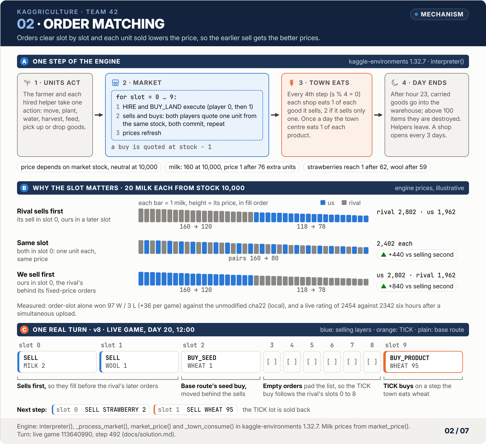
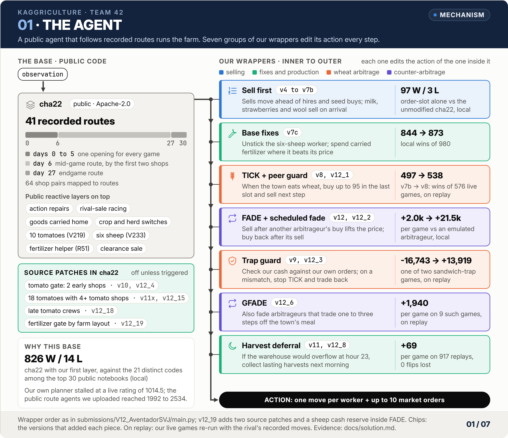
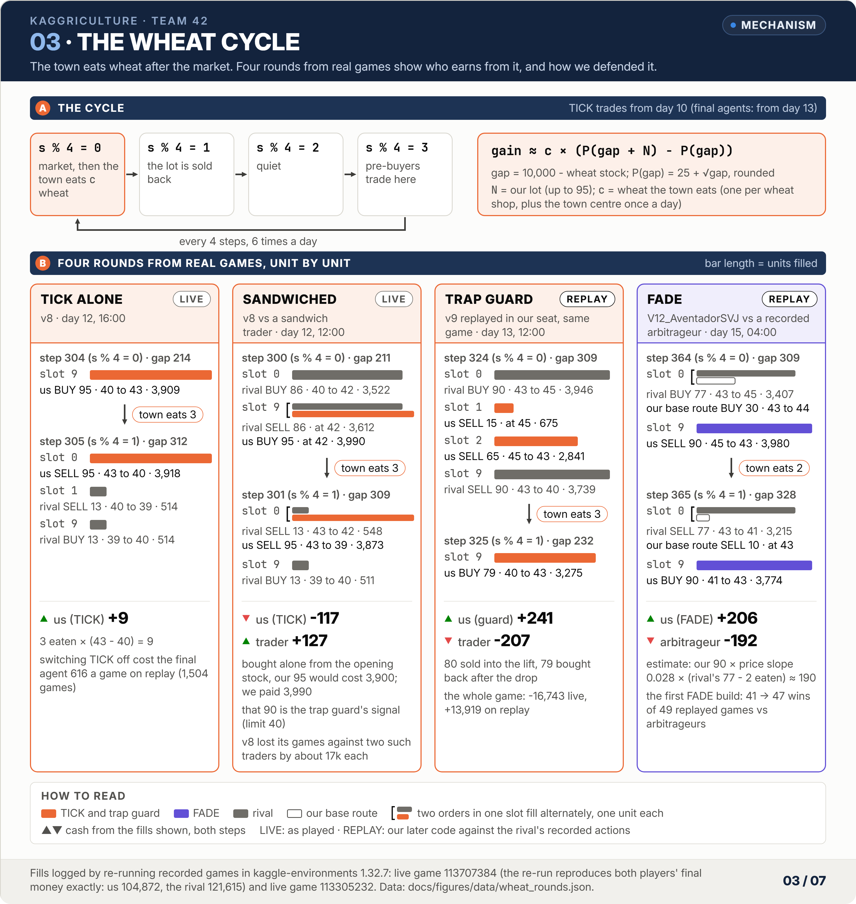

# Solution: technical reference

This page describes the final agents of team 42 layer by layer: the engine mechanics they rely on, the public base agent, and every layer we added, with the evidence that kept it in. For results see [postmortem.md](postmortem.md); for how the evidence was produced see [evaluation.md](evaluation.md).

## Contents

- [The game](#the-game)
- [Engine mechanics that shaped the solution](#engine-mechanics-that-shaped-the-solution)
- [The base agent: cha22](#the-base-agent-cha22)
- [Names used in this repository](#names-used-in-this-repository)
- [Architecture](#architecture)
- [Layer reference](#layer-reference)
- [1. Order-slot priority](#1-order-slot-priority)
- [2. Selling into shallow markets](#2-selling-into-shallow-markets)
- [3. Fixes to the base's behaviour](#3-fixes-to-the-bases-behaviour)
- [4. TICK: wheat arbitrage around the town's consumption](#4-tick-wheat-arbitrage-around-the-towns-consumption)
- [5. Defending TICK: peer guard and trap guard](#5-defending-tick-peer-guard-and-trap-guard)
- [6. FADE: trading against other arbitrageurs](#6-fade-trading-against-other-arbitrageurs)
- [7. Production patches](#7-production-patches)

## The game

| Rule | Detail |
|---|---|
| Length | 720 steps = 30 days × 24 hours; step 718 is the last executed action |
| Farm | 10 × 10 tiles in four 5 × 5 quadrants; the north-west one is free, the others cost 1000, 2000 and 4000 |
| Production | wheat, carrot and melon are harvested once; tomato and strawberry several times; geese (eggs), cows (milk) and sheep (wool) need a building and 1 wheat a day; crops need water every day; fertilizer and care raise yields; every animal yields 1 fertilizer a day |
| Labour | one farmer; helpers are hired for a day, and the n-th hire of the day costs Fibonacci(n) (1, 1, 2, 3, 5, 8, 13, 21, 34, 55, 89, 144, 233, ...) |
| Warehouse | 100 items; whatever overflows at the end of the day is destroyed |
| Market | up to 10 orders per step; each good's price is a function of how far its market stock is from 10,000; only wheat and fertilizer can be bought |
| Town | a random shop opens every 3 days (with replacement, up to 8); each shop eats one of each of its goods every 4 steps, and the town centre eats one of everything once a day |
| Winner | more money at the end; unsold goods are worth nothing |
| Ranking | only each team's 2 latest submissions play; a new upload retires the older one; up to 5 uploads a day; a new submission starts at 600. After the deadline the active submissions play on for about two weeks. The final board is a Bradley-Terry fit on wins only (draws count half) over all games in which both sides were still active at the end, and a team is ranked by its better submission |

## Engine mechanics that shaped the solution

All of these were checked in the engine source of `kaggle-environments` 1.32.7.

<picture>
  <source media="(prefers-color-scheme: dark)" srcset="img/02_order_matching_dark.png">
  
</picture>

| Mechanic | How we used it |
|---|---|
| Each step: unit actions, then the market slot by slot, then the town eats (every 4th step), then the end of day at hour 23 | Everything below follows from this order |
| Orders are matched slot by slot. In each slot, hires and land purchases execute first; then both players' buy and sell orders in that slot fill one unit at a time, alternately, at the same price | Put sell orders early; put arbitrage orders in the last slot |
| High-value markets are shallow: above the neutral stock of 10,000, milk reaches price 1 after 76 extra units, strawberries after 62, wool after 59 (`market_price`) | The first seller gets the price |
| On steps with `s % 4 == 0` the town consumes after matching | Buy wheat on that step, sell it on the next |
| Goods sold at price 1 do not enter market stock | Selling at the floor does not depress the price further |
| Before each shop draw, every empty tile on both farms draws a weed random number | The same seed gives different shops if empty-tile counts differ, so local A/B tests must force the shop order |
| The loader takes the last callable in the module as the agent | A wrapper has to remove the original agent from `globals()` |

An illustration with the engine's prices: sold first, 20 milk from a stock of 10,000 earn 2,802; sold second, 1,962; in the same slot, 2,402 each.

## The base agent: cha22

[cha22 agent](https://www.kaggle.com/code/abhinav0370/cha22-agent) (Abhinav0370, Apache-2.0) is the culmination of the public route-replay lineage: thomastschinkel's state routing, yhay81's shop-based route choice, Ahmed Berat Ozer's V series (V39), plus layers by destbreso, aurax7, tetsutani, prvsiyan, Dmitrii Gluzdov and others. On Sep 24 several of the highest-scoring public notebooks (Master Engine V3, Multi-Route, demand-preserving) were byte-identical to it.

| Part | What it does |
|---|---|
| Recorded routes | 41 action tapes of 719 steps, taken from past high-scoring games. Days 0 to 5 follow one opening; on day 6 (step 144) a mid-game route is chosen by the first two shops (64 shop pairs mapped; a wool shop among the first two selects a wool route); on day 27 (step 648) every game switches to an endgame tape |
| Opening | step 0 buys 5 wheat (feed) and 1 wheat seed; step 1 hires 5 helpers and buys 2 cows and 2 sheep |
| Reactive layers | dozens of public layers on top of the tapes: repairs of failed actions, watering and weeding rescue, sell lead, RACE (infer rival sales from stock changes and pull planned sales earlier, up to about 44 steps), COURIER (carry high-value goods home after noon), CARROT and HERD (switch crops or animals by the shops that opened), V219 (tomatoes in the south-east quadrant), V233 (six sheep with a dedicated worker in the south-east), R51 (fertilizer helper), a final clearance sale |
| Typical farm (median of 80 self-play games) | north-east quadrant on day 6, south-west on day 11, south-east on day 18 in 19% of games; by day 15: 8 cows, 6 sheep, 3 geese; per game it plants wheat 154 times, carrots 40, strawberries 33, melons 12, rarely tomatoes; 117 fertilizer applications, 404 care actions, 471 idle helper steps; about 100k at the end |

Why we built on it: on Sep 24 we played the 21 distinct codes among the top 30 Code-page notebooks against it, 40 games each; cha22 with our first layer won 826 and lost 14. Our own uploads of Sep 24 confirmed the choice: the verbatim cha22 reached 2333.4 in 7 hours against 2100.5 for the verbatim rescue in 10.8, and with our first layer 2481 after 10 hours against 2180.5 after 10.8 hours. (The cha22 author's own long-running submission stood at about 2588 that day.)

## Names used in this repository

| Name | Meaning |
|---|---|
| RACE | public base module: infers rival sales from stock changes and pulls planned sales earlier |
| COURIER | public base module: carries high-value goods home after noon |
| CARROT, HERD | public base modules: switch crops or animals by the shops that opened |
| HD2 (HERD2) | public base module: when the route first buys geese, switch to cows or sheep if their expected value is clearly higher |
| V219 | public base module: buys the south-east quadrant on day 18 and plants 10 tomatoes |
| V233 | public base module: six sheep with a dedicated worker in the south-east |
| R51 | public base module: supplementary fertilizer helper |
| order-slot | our first layer: sells move ahead of hires and seed, animal and land purchases from step 288 |
| eager sell | sell milk, strawberries and wool as soon as they reach the warehouse |
| sell ordering | order same-step sells by the cost of being undercut |
| room guard | at hour 23, sell what the warehouse would destroy |
| wheat lead | sell now the wheat the route sells in the next 2 steps, keeping 4 steps of feed |
| SHEEPFEED | fix for the six-sheep worker that stalled a whole day without wheat |
| FERTMORE | use carried fertilizer instead of letting the route sell it |
| eod2 | end-of-day harvest deferral |
| TICK | our wheat arbitrage around the town's consumption step |
| peer guard | stops TICK when a rival runs the same arbitrage from an earlier slot |
| trap guard | detects traders who prey on TICK by checking our cash against our own orders, then trades back |
| rev_guard | public-line variant of the peer guard that stops TICK only for rivals trading against it |
| FADE | trades against other teams' wheat arbitrage: sells after their buy, buys back after their sell |
| scheduled fade | FADE against a public layer that trades wheat at five fixed steps |
| GFADE | FADE against arbitrage one to three steps off the town's meal |
| P&L guard | switches FADE off when its inferred margin turns negative |
| x18g | 18 tomatoes instead of 10 in worlds with 4+ tomato shops |
| v11x | research name of V10_CarreraGT |
| replay | a live-replay counterfactual: our live game re-run with the rival's recorded actions and the real shop order |
| panel | local games against opponents that react |
| flip | a game whose result changes (won to lost or lost to won) |
| slot | the position of an order in a player's list of up to 10 market orders |

## Architecture

<picture>
  <source media="(prefers-color-scheme: dark)" srcset="img/01_agent_dark.png">
  
</picture>

The final agents stack, from the inside out (as in `submissions/V12_AventadorSVJ/main.py`):

1. the cha22 base, with our source patches: the tomato gate (v12_4), 18 tomatoes (x18g, v12_15) and, in v12_19, late tomato crews and the layout-adaptive R51 gate;
2. the selling block: eager sell, order-slot, room guard, sell ordering;
3. wheat lead;
4. SHEEPFEED;
5. FERTMORE;
6. TICK with the peer guard (from day 13 since v12_1);
7. FADE, with the 2N position, wind-down, precise room and sell cap (and, in v12_19, the sheep cash reserve);
8. scheduled fade;
9. the trap guard, with the P&L guard and the pre-buy rule;
10. GFADE;
11. end-of-day harvest deferral (outermost).

Each wrapper calls the one inside it and edits the returned action; the source patches are exact-count text substitutions (with the switch off, the code is identical line by line). Each package's `NOTICE.txt` lists its changes.

## Layer reference

| Layer | Added in | What it does | Main evidence |
|---|---|---|---|
| cha22 base | v4 | 41 recorded routes plus dozens of public reactive layers | with our order-slot layer, local 826 W / 14 L against the 21 distinct public codes from the Code page |
| order-slot | v4 | from step 288, move sell orders ahead of hires, seed, animal and land purchases | local 97 W / 3 L against the unmodified cha22 |
| room guard | v5 (live from v6) | at hour 23, sell what the warehouse would destroy | panel 140 → 154 wins of 210 |
| eager sell | v6, v6b | sell milk, strawberries and wool as soon as they reach the warehouse, if the quote is at least 0.3× base | replays flip 9 of v4's 19 losses |
| sell ordering | v6 | order same-step sells by how much an earlier rival sale would cost us | same as above |
| wheat lead | v7b | sell now the wheat the route sells in the next 2 steps, keeping 4 steps of feed | +500 per game for us, -720 for the mirror rival |
| SHEEPFEED | v7c | fix cha22's six-sheep worker stalling a whole day when the warehouse has no wheat | all 5 affected replays improve |
| FERTMORE | v7c | use carried fertilizer the route would not use on crops where it is worth more than its quote | local 844 → 873 wins of 980 |
| TICK | v8 | buy wheat in the last slot when the town eats wheat, sell it next step; stop if the rival does the same | live replays 497 → 538 wins of 576 |
| trap guard | v9 | detect rivals that prey on TICK (sandwich, pre-buy) by reconciling our own cash; stop TICK and counter-trade | v8's last 94 replays 59 → 62 wins, 0 flips lost |
| tomato gate | v10, v12_4 | V219 tomato investment also with 2 tomato shops if they opened early | 212 replays with exactly 2 such shops: 188 → 192 wins |
| pre-buy trap extension | v11, v12_7 | also catch rivals that buy at `s % 4 == 3` and sell into our tick buy | the day's 12 worst losses: kwon -18258 → +23767 |
| end-of-day deferral | v11, v12_8 | when workers would bring home more than the warehouse holds at hour 23, postpone non-expiring harvests to the next morning | 917 replays +69 per game, 0 flips lost |
| FADE | v12 | when a rival runs tick arbitrage, sell after its buy lifts the price and buy back after its sell drops it | live replays 568 → 574 wins of 607; emulated arbitrageur +2.0k → +21.5k per game |
| scheduled fade | v12_2 | 50 to 76 teams buy wheat at fixed steps 327, 375, 419, 435, 487 with one public layer; buy one step earlier and sell into their buy | +552 per game in 74 such games |
| FADE P&L guard | v12_5 | infer the per-unit margin exactly from next-step stock; switch FADE off if 4 rounds average -1.2 or worse | still profitable against emulated anti-faders |
| GFADE | v12_6 | fade arbitrage in phases 1 to 3 as well (the public "one step off" layer) | 9 such replays +1940 per game |
| 2N position | v12_9 | fade position up to twice the rival's lot | latest 90 replays +50 per game |
| wind-down | v12_11 | no buy-back after the last fade step; sell the whole position into the rival's lift | 917 replays: 5 games change, all better |
| precise room | v12_12 | reserve warehouse room only for workers the route will unload in the next 3 steps | 917 replays +174 per game |
| sell cap | v12_13, v12_14 | while a rival arbitrages 40+ per round, cap the base's wheat sells to its own wheat | 917 replays +161 per game |
| 18 tomatoes (x18g) | v11x, v12_15 | 18 tomatoes instead of 10 when 4+ of the first 6 shops by day 18 are pizza or farmers' market | tomato-heavy panel 160 W / 0 L; +1391 per game on the public line (v11x vs v11), +1265 on the ace (v12_15 vs v12_14) |
| sheep cash reserve | v12_17 (in v12_19) | skip one FADE buy on day 11 so the base can afford 6 more sheep in wool worlds | new wool worlds 184 → 187 wins of 192 |
| late tomato crews | v12_18 (in v12_19) | hire the 18-tomato crews only on days 27 to 29 | v12_18 against the ace (with the cash reserve): 1480 replays 1219 → 1222 wins |
| layout-adaptive fertilizer | v12_19 | compare the two public farm layouts at steps 264 to 280; if they differ, loosen the base's R51 fertilizer gate | v12_19 against the ace (with the two rows above): 1572 replays 1259 → 1269 wins, 10 flips won, 0 lost |

"Replays" are live-replay counterfactuals (our recorded live games re-run with the rival's recorded actions and the real shop order); "panel" and "local" are games against local opponents that react. See [evaluation.md](evaluation.md).

## 1. Order-slot priority

The engine fills both players' orders slot by slot, alternating unit by unit at the same price within a slot. Public agents often put empty orders and fixed-price orders (hiring, seeds, animals, land) in front of their sells, so a rival's sell in an earlier slot fills first and takes the better price.

From step 288 (day 12) we drop empty orders and move `HIRE`, `BUY_SEED`, `BUY_ANIMAL` and `BUY_LAND` behind the sells. `SELL` and `BUY_PRODUCT` keep their relative order and no quantity changes. Doing this from step 0, or moving `BUY_PRODUCT` as well, breaks the opening (0 W / 36 L locally).

- Local: 97 W / 3 L against the unmodified cha22 (+36 per game); 90.2% score against six public-level agents, the best of the field.
- Live: six hours after a simultaneous upload, 2454 against 2342 for the unmodified cha22 (which was replaced after 7 hours at 2333.4); v4 went on to 2504.5 after 19.6 hours.
- The same layer on the rescue base (v3) beat the unmodified rescue uploaded at the same moment by 80 points all day; locally 49.0% → 71.0% on the same seeds and opponents, with no game getting worse.
- Code: `tools/build_submission.py` (embeds the base source compressed and verbatim, keeping its Apache-2.0 LICENSE and NOTICE).

```bash
python tools/build_submission.py <base main.py> <out dir> --license <LICENSE.txt> --notice <NOTICE.txt> --label "<base name>" --date YYYY-MM-DD
```

A real turn: in live game 113640990 at step 492 (day 20, 12:00) v8 sent slot 0 `SELL MILK 2`, slot 1 `SELL WOOL 1`, slot 2 `BUY_SEED WHEAT 1`, slots 3 to 8 empty and slot 9 `BUY_PRODUCT WHEAT 95`; the next step it sent `SELL STRAWBERRY 2` and `SELL WHEAT 95`.

## 2. Selling into shallow markets

Milk, strawberries and wool are high-value but shallow: 59 to 76 surplus units take the price to 1 (76 milk, 62 strawberries, 59 wool). In v4's live losses around 2450, 13 of 19 came from cha22 variants that sell milk the moment it arrives, from slot 0. cha22 sells in small lots on its tape schedule, so in an oversupplied market it sells late and cheap.

- **Eager sell** (v6, v6b): from step 288 to 700, whatever milk, strawberries and wool the step's own orders leave in the warehouse is sold at once if the quote is at least 0.3× the base price. v6 also had a ceiling at 0.9× (above it, demand exceeds supply and waiting pays); v6b removed the ceiling, which won more on both local panels and live replays. Replaying v4's 19 losses with v6 flipped 9 of them; against an emulation of the "sell on arrival" variants, 10 W / 50 L became 33 W / 27 L. The cost: against morewheat 56 W / 4 L became 52 W / 8 L.
- **Sell ordering** (v6): same-step sells are reordered by the loss we would take if the rival sold the same amount in an earlier slot, computed with the engine's price function, largest first. Swaps only happen between occupied slots and only when the difference is at least 10, so mirror rivals keep their order.
- **Wheat lead** (v7b): sell now (in the last slot) the wheat the route will sell in the next 2 steps, after reserving the feed the route will pick up in the next 4 steps. Without the reserve, the tape still sells its planned wheat later and sells the feed when wheat is short: one replay went from +2851 to -7095. Mirror rivals sell wheat on the same schedule, so selling first is worth about +500 per game to us and -720 to them. A lead of 3 steps was clearly worse (27 W / 13 L against cha22, against 38 W / 2 L for 2 steps).
- **Room guard** (v5, live from v6): at hour 23, predict the warehouse after this step's unit actions, orders and day-end unloading with the engine's rules, and sell whatever would be destroyed (wheat and fertilizer included). Panel: 140 → 154 wins of 210.

The v7 experiment is a cautionary tale: an overnight search on 40 fixed worlds chose an eager band of 0.2× to 1.4×. On fresh worlds the 0.2× floor sold too early against steady rivals (morewheat, rescue, herdsafe): 365 wins (v6b) against 300 (v7) of 420. v7b kept the wheat lead and restored the 0.3× floor.

## 3. Fixes to the base's behaviour

These are wrappers, not source patches: they watch the base's actions and correct them.

- **SHEEPFEED** (v7c): cha22's dedicated worker for six sheep in the south-east issued "take 0 wheat" every step when the warehouse had none, and its own wheat rescue never fired if the step had any wheat order (which the tape and the wheat lead often do). The sheep went unfed and uncared for a whole day, about 5000 per wool game. The fix takes over only after 2 stalled steps: feed the nearest hungry sheep from what the worker carries, otherwise care or shear; if the sheep lack feed, trim this step's wheat sells, then buy. All 5 affected live replays of 316 improved (Robson: -5273 → -113); 420 local games were unchanged.
- **FERTMORE** (v7c): cha22 sells most animal fertilizer for 10 to 20 late in the game and fertilizes only day-old wheat and carrots. From step 288 to 690, when a worker carries fertilizer the route will not use today, the step is a `PASS` or redundant watering, and the extra yield under the worker is worth more than the fertilizer quote, we fertilize instead. Strawberries only get it in place of watering when a simulation shows the route will water that tile tomorrow. Local 844 → 873 wins of 980; on replays the wins were unchanged and money rose by about 90 per game. Letting workers pick up extra fertilizer from the route (`--extra 2`) took fertilizer the route needed later and lost badly.
- **End-of-day harvest deferral** (v11, v12_8): in 155 of 200 live games, workers brought home more at hour 23 than the warehouse could take, destroying 178 per game on average. When that is about to happen, last-step harvests of animal products and of tomatoes and strawberries that will not expire are turned into "stay" and collected the next morning; fertilizer and one-time crops are still harvested. Deferring everything (eod1) also deferred carrots and wheat that die overnight and flipped 4 games to losses.

## 4. TICK: wheat arbitrage around the town's consumption

<picture>
  <source media="(prefers-color-scheme: dark)" srcset="img/03_wheat_cycle_dark.png">
  
</picture>

While studying unusual play among the top 30, we found that only Otter Vibe (then #15) traded wheat around the town's consumption step: about 76 times and 5700 units per game. Replaying its games without those trades cost it about 650 per game.

The mechanism: on steps with `s % 4 == 0` the town eats wheat (one per wheat shop, plus the town centre once a day) **after** the market has matched. If we buy N units on that step and sell them on the next, the c units the town eats are taken out at the price we pushed up, so the round trip earns about c × (P(gap + N) - P(gap)). For wheat below the neutral stock, P(gap) = 25 + √gap, rounded.

From day 10, on every such step we buy up to 95 wheat in the last slot (slot 9; padding with empty orders so we fill after the rival's orders in slots 0 to 8), limited by cash and by free warehouse room in the worst case (everyone standing on the warehouse at the end of the step unloads everything), and skip the trade if the expected gain is below 3. The next step we sell the lot, merged with the base's own wheat sells or placed after its first few sells. The base sees the warehouse without this lot, so its own feeding and trading are untouched.

Evidence: live replays 497 → 538 wins of 576 (v7b → v8, so the v7c fixes are included); on v7b's own 136 live games, 13 flips won and 1 lost; locally on fresh seeds 348 (v7b), 376 (v7c), 419 (v8) wins of 420; head-to-head against v7b 60 W / 0 L; 360 W / 0 L against 12 public agents; on 273 games of the top 120 replayed from both seats, 227 → 250 wins (+668 per game). Two hours after upload v8 stood at 2594, while v7c and v7b had been at 2280 and 2172 at the same age. Code: `gold/tick/mk_tick.py`, `gold/tick/pack.py`; the threshold-10 variant with `tools/build_v8x.py --th 10`. Switching TICK off cost the final agent 616 per game on 1,504 replays (112 flips lost, 3 won).

**Four rounds in numbers.** Fills logged by re-running the recorded games in the engine (the re-run reproduces both players' final money in the live game exactly: us 104,872, the rival 121,615). Figure 03 shows the same rounds unit by unit.

| Round | Game | Live or replay | Steps | Our trades | The other side | Town ate | Our result | Theirs |
|---|---|---|---|---|---|---|---|---|
| TICK alone | 113707384 | live (v8) | 304, 305 | buy 95 in slot 9 for 3,909; sell 95 in slot 0 for 3,918 | sells 13 and buys them back (slots 1 and 9) | 3 | +9 | 0 |
| Sandwiched | 113707384 | live (v8) | 300, 301 | buy 95 in slot 9 for 3,990; sell 95 in slot 0 for 3,873 | buys 86 in slot 0 for 3,522 and sells them into our buy in slot 9 for 3,612 (+90); the next step sells 13 for 548 and buys them back for 511 (+37) | 3 | -117 | +127 |
| Trap guard | 113707384 | replay (v9 in our seat) | 324, 325 | sell 80 in slots 1 and 2 for 3,516; buy 79 back in slot 9 for 3,275 | buys 90 in slot 0 for 3,946; sells 90 in slot 9 for 3,739 | 3 | +241 | -207 |
| FADE | 113305232 | replay (V12_AventadorSVJ in our seat) | 364, 365 | sell 90 in slot 9 for 3,980; buy 90 back in slot 9 for 3,774 (the base's own buy of 30 and sell of 10 in slot 0 are not counted) | buys 77 in slot 0 for 3,407; sells 77 in slot 0 for 3,215 | 2 | +206 | -192 |

Two checks: TICK alone earned 3 eaten × (43 - 40) = 9; the FADE estimate X × slope × (N - c) gives 90 × 0.028 × (77 - 2), about 190, against the measured +206. In the sandwiched round our own orders should have cost 3,900; the trade cost 3,990, and the trap guard is built on exactly that difference.

## 5. Defending TICK: peer guard and trap guard

**Peer guard** (v8). Stock changes reveal the rival's wheat flow exactly: the market change equals our net sales plus the rival's net sales minus the town's consumption, and the reconstruction matched the rival's real orders unit for unit. If the rival twice in the last 8 ticks buys 10+ at the tick and sells 10+ the next step, TICK stops for the game. Without it, a cluster of teams running the same public arbitrage from slot 0 always filled first and made us buy high and sell low: -3000 to -11000 per game. The threshold went from 30 to 10 units to catch small arbitrageurs such as Mositaku (20 per trade): that replay was -3822 at 30, -39 at 15 and +81 at 10. At 10 against 30, only 9 of 658 replays changed and none flipped to a loss.

**Trap guard** (v9). Within half a day of v8 going live, rivals appeared that preyed on it:

- **Sandwich** (Sho Saga, lumen): at `s % 4 == 0` buy 80 to 90 in slot 0 to lift the price and sell the same amount in slot 9, straight into our slot-9 tick buy; reverse the next step. Their net flow per step is zero, so the peer guard could not see them. v8 lost its games against them by about 17k each (-16,743 and -17,114).
- **Pre-buy** (Takahiro Katsumata, Kaggriculture Agent): buy at `s % 4 == 3`, then sell together with our tick sell.

Money only moves in the market, so each step we simulate the cash effect of our own final orders with the engine's rules and compare it with the actual cash next step (skipping steps where the rival also traded our other goods). Three rounds losing 40+ among the last 4 clean rounds, or a flow pattern of buying 25+ at `s % 4 == 3` and selling 25+ at `s % 4 == 1` seen twice, stops TICK for the game. The guard then counter-trades: against a sandwich it sells wheat at the tick in a middle slot, after their lift and before their sell; against a pre-buyer it sells at `s % 4 == 3`; in both cases it buys the position back in the last slot at `s % 4 == 1`, and it stops after 8 rounds without profit.

Evidence: on v8's last 94 live replays 59 → 62 wins with no flipped losses (Sho Saga -16743 → +13919, lumen -17114 → +10419, Takahiro -3967 → +4537, Kaggriculture Agent -5243 → -28); on all 711 replays 626 → 629; the local panel of 140 games was unchanged. A defence-only variant (`tools/add_sandguard.py`, kept as v8b) only turned Sho Saga into +28 and left lumen at -3501. Code: `gold/front/mk_tguard.py`, packed with `gold/front/pack_tguard.py`.

**Pre-buy extension** (v11, v12_7). On Sep 27 two cha22 mirror variants (kwon yong deuk, curiosity) bought 73 to 90 at `s % 4 == 3` from slot 0 or 1 and sold at `s % 4 == 0` in slot 9, filling against our last-slot tick buy; v10 lost 11k to 18k per game to them. The pre-buy rule now also counts a rival that buys 25+ at s0-1 and sells 25+ at s0 or s0+1 (except at the five scheduled-fade steps). The day's 12 worst losses: kwon -18258 → +23767, curiosity -11201 → +139, the other 10 unchanged. Turning off the flow reconstruction (`GUARD=0`) blinded the guard and lost the kwon game by 18k again.

**rev_guard** (public line only, v11 and V10_CarreraGT). Stop TICK only for rivals that trade against it (selling 10+ when we buy and buying 10+ back the next step, twice in the window), not for rivals arbitraging in the same direction, so plain peers no longer get the tick profit to themselves. It conflicts with FADE (TICK never stops, so FADE never starts), so the v12 line handles peers with FADE instead.

## 6. FADE: trading against other arbitrageurs

About 27 of the top 120 teams ran tick arbitrage, almost all from slot 0. Once the guard identifies one, FADE trades against it: right after its buy lifts the price at the tick we sell up to 90 wheat in the last slot, and after its sell drops the price the next step we buy them back in the last slot. Selling X units this way earns roughly X × slope × (N - c) per round, where N is the rival's lot and c the town's consumption, and the rival's sell lands in a market we have just restocked. This needs a rotating inventory of up to 90 wheat on top of the route's future feed; without it the warehouse only holds about 10 idle wheat and there is nothing to sell. The guard also recognises rivals that sell at the tick and buy the next step, and TICK resumes after the rival has stopped for 6 small cycles (v8 stopped for the whole game).

FADE was the first change whose payoff grows with the rival's arbitrage volume. Against v8 it went 60 W / 0 L (+905 per game); on 607 live replays 568 → 574 wins (7 flips won, 1 lost); on the 49 games against arbitrageurs 41 → 47; against an emulated arbitrageur (`research/panel/emu_tick0`) +2.0k → +21.5k per game. With no arbitrageur present it plays exactly like v8. Code: `tools/add_fade.py`, `tools/build_v8x.py --resume 6 --fadeguard --fade 90`.

The v12 line then refined it one change at a time, each kept in its own package under `submissions/`:

| Version | Change | Evidence |
|---|---|---|
| v12_1 | start TICK on day 13, so guarded peers move first and FADE has something to trade against | |
| v12_2 | scheduled fade: 50 to 76 teams used one public layer that buys 63 to 89 wheat at steps 327, 375, 419, 435 and 487 and sells the next step; we buy up to 80 one step earlier in the last slot and sell into their buy (`gold/front/mk_sfade.py`) | 74 such games +552 per game (2 flips won, 0 lost); 413 replays +63 per game |
| v12_3 | trap guard (the v9 layer) | v8's last 94 replays: 59 → 68 wins; all 711 replays: v8 626, v9 629, v12_3 645 |
| v12_4 | tomato gate (the v10 patch) | latest 273 replays: 2 flips won, 0 lost; panel 385 → 389 wins of 390 |
| v12_5 | P&L guard: both legs sit in the last slot, so the fill price can be inferred exactly from next-step stock; FADE switches off and sells its position if 4 rounds average -1.2 per unit or worse | a threshold of 0 switched FADE off wrongly in 69 of 917 replays (public slot-0 arbitrageurs swing between -0.7 and +0.9); FADE stays net positive against emulated anti-faders |
| v12_6 | GFADE: also fade arbitrage in phases 1 to 3, mostly the public "one step off" layer (buy 45 to 86 at `s % 4 == 3` from slot 0 or 1, sell the next step; kyy666, len8487, emreaydin and others) | 9 such replays +1940 per game, 1 flip won (emreaydin -2526 → +263); 917 replays: 14 games change, +19 per game |
| v12_7 | pre-buy trap extension (as in v11) | kwon +23904; 917 replays 2 flips won, 0 lost |
| v12_8 | end-of-day harvest deferral (as in v11) | 917 replays: 476 games change, +69 per game, 2 flips won, 0 lost, worst -412 |
| v12_9 | position up to 2N (still within 90, room and feed): the rival's buy-back sells into the market we refilled, so the optimum is twice its lot | latest 90 replays +50 per game, 1 flip won (Ilya & Yurnero trades 28 per round: FADE sold only 28 and lost 119 there, while our public line's counter layer with a fixed 80 made +1382); emulated 30-unit arbitrageur +5712 per game (v12_8: +3860) |
| v12_10 (rejected) | squeeze: with a full order list, replace small fertilizer, egg, carrot, tomato and melon sells by unsold milk, strawberries and wool | 917 replays +0 per game, 4 flips won, 3 lost; exact pricing of 1592 cases on 150 games: always squeezing -429 per game |
| v12_11 | wind-down: no buy-back after step 713, and the last fade step sells the whole position into the rival's lift | Ilya & Yurnero +663 → +1258; 917 replays: 5 games change, all better (+182 to +759) |
| v12_12 | precise room: reserve warehouse room only for workers the route unloads in the next 3 steps (the position had averaged only 47 while rivals traded 60 to 90) | 917 replays +174 per game; 27 games with 40+ arbitrage rounds +4642 per game; emulated arbitrageur +33.5k per game (v12_11: +21.5k) |
| v12_13 | while a rival keeps arbitraging, cap the base's own wheat sells to its own wheat (warehouse minus the fade position), except at hour 23; the base had been dumping the fade position in phase 3 and buying it back in phase 0 | Ken_Ken_Pa +11166 → +13648; 917 replays +161 per game, 1 flip won, 1 lost; but an emulated 30-unit arbitrageur fell from 24 W / 0 L to 22 W / 2 L |
| v12_14 | apply the cap only against rivals averaging 40+ per round | emulated 30-unit arbitrageur back to 24 W / 0 L; panel 189 W / 3 L |
| v12_15 | 18 tomatoes (x18g, from the public line); rev_guard and an earlier TICK start were not ported because both conflict with FADE (on the ace, rev_guard and TICK from day 10 or 12 each lost one flipped game on 917 replays) | 917 replays +52 per game, no flips; tomato-heavy panel +1265 per game against v12_14 (+1391 on the public line, v11x vs v11); against v11x on the same 917 replays 823 vs 817 wins, +355 per game |

v12_15 was uploaded as `V12_AventadorSVJ` (`gold/front/pack_final_ace.py` renames the package; `main.py` is byte-identical). On 1478 replays it beat the V10_CarreraGT code by 24 flips to 7 (+451 per game). The gain came from the roughly 10% of games against arbitrageurs (+5000 per game); the other 90% lost about 30 per game, the cost of starting TICK on day 13.

## 7. Production patches

Late in the competition we added small, gated production changes inside the base source. Each is off unless its condition holds.

- **Tomato gate** (v10, `tools/patch_base.py --patch v219n2e`): V219 buys the south-east quadrant on day 18 and plants 10 tomatoes, but needed 3 pizza or farmers'-market shops among the first 6. Two are now enough if they opened early (24+ shop-days by day 18, that is on days 3 and 6 or 3 and 9). Relaxing to 2 shops without the timing condition lost (722 replays 633 → 620 wins, 18 flips lost); split by timing, only the 30 games with early shops gained (+1777 per game). With the gate: 212 replays with exactly 2 such shops 188 → 192 wins, 0 flips lost; on fresh seeds forcing two early tomato shops, +2380 per game against four opponents with 28 flips won and 0 lost. About 4% of live worlds qualify. The trigger was koren sabag, a cha22 variant that planted tomatoes in a 2-pizza-shop world and beat us by 5.3k.
- **18 tomatoes** (x18g, `research/carrera/patch_x18g.py`): with 4+ pizza or farmers'-market shops among the first 6 by day 18, V219 plants 18 tomatoes instead of 10 (8 more tiles in rows 7 and 8), regroups the crews (2 crews of 9 tiles normally; 3 crews of 6 on days 18, 24 and 26 to 28), buys 18 seeds, fertilizes 10 tiles, and brings tomatoes home before the day ends. Without the gate the crews worked past midnight and overflow destroyed up to 13k of tomatoes in a test game; with delivery but no gate (x18b) worlds with 2 to 3 tomato shops lost 500 to 1100 per game, while 4 shops gained 1176 and 5 shops 4335. With the gate: 43 of 531 tomato-world replays change (38 better, 5 worse), +130 per game, no flips; a tomato-heavy panel 160 W / 0 L, +1391 per game on the public line (v11x vs v11) and +1265 on the ace (v12_15 vs v12_14).
- **Sheep cash reserve** (v12_17): on day 11 at hour 1, in worlds with two wool shops, the south-east still closed and the base's price conditions met, skip one FADE buy so the base can afford its 6 extra sheep. Found in one replay where a 90-wheat FADE buy delayed the sheep by a day (-913 → +4847). 1480 replays 1219 → 1220 wins; 24 new wool worlds × 8 opponents 184 → 187 wins of 192.
- **Late tomato crews** (v12_18): an execution audit of the 18-tomato worlds (a rival with the same 18 tomatoes sold 142, we sold 92 and lost 4 plants to missed watering). Four crews from day 24 (crew4_full) gained 4920 per game in tomato worlds but flipped one panel game, because the crews cost 5401 for 3204 more tomato revenue; v12_18 keeps the crews only on days 27 to 29. 1480 replays 1219 → 1222 wins, +193 per game, 0 flips lost.
- **Layout-adaptive fertilizer** (v12_19): at steps 264, 272 and 280 compare the two public farm layouts and decide at step 287. If the similarity is below 0.94 all three times, loosen the base's R51 supplementary fertilizer gate (cost 1.0× plus 20, path penalty 0.75, at most two workers); with similar layouts the original rule stays. No identities, replays or seeds are hard-coded. Triggered by an audit of the latest losses on Sep 30 (about 3.9k, 3.7k and 2.9k short in tomatoes, strawberries and eggs). Against the ace (so including the cash reserve and late crews): 1572 replays 1259 → 1269 wins, 10 flips won, 0 lost, +266 per game; 360 local reacting-panel games and 112 local production-only games unchanged. The report itself notes the historical gain is only 0.64 percentage points and does not prove anything against the new production-heavy finals.
